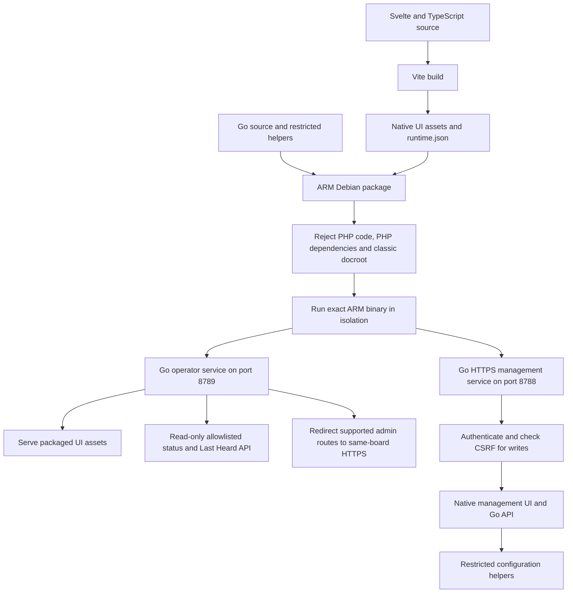
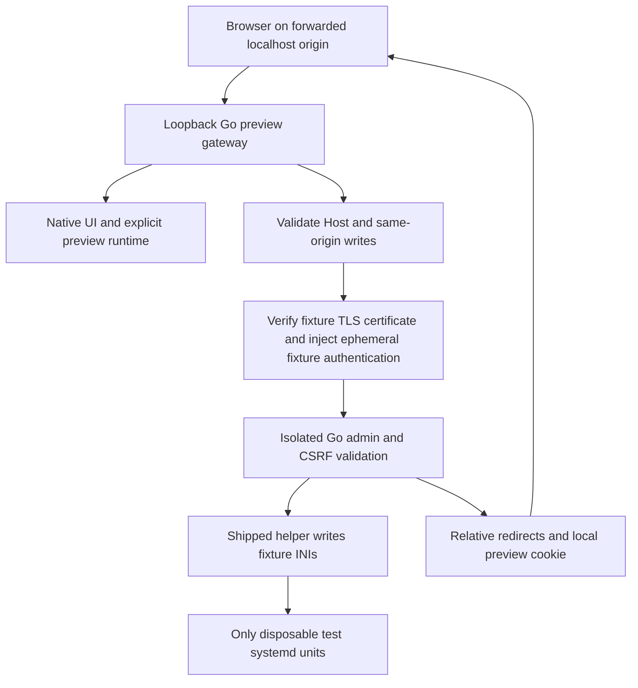

# Native package and request flow

The reference PHP checkout is not a build input or a runtime dependency. This flow covers native packaging and HTTP serving; it does not claim that all legacy operations have been migrated.

## Isolated interactive preview

Preview navigation stays on one browser origin. No host port 8788, real board credentials, PHP runtime, or radio hardware is used. The gateway is QA-only; production TLS and authentication remain unchanged.
